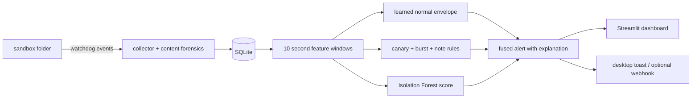

<div align="center">

# 🛡️ RansomRadar

**Explainable ransomware early warning for a sandbox folder.**

It watches files, catches ransomware-style behaviour in seconds, and every alert
tells you exactly why it fired, in plain sentences.


*Class project, built to be demoed. Every "attack" comes from our own benign
simulator. Detection is passive: it writes flags to a local SQLite file and
touches nothing outside `sandbox/`.*

<!-- TODO: record a 15 s capture of `python demo.py` running, trim it to a GIF
(ScreenToGif works), save as docs/demo.gif, then uncomment:
<p align="center"></p>
-->

</div>

## 🎬 What a run looks like

Real output from a real run, verbatim:

```text
[collector] 18:34:17 modified canaries\Q4_Payroll_Report.docx (H=7.9/8, TYPE MISMATCH)
[collector] 18:34:17 modified canaries\FY27_Budget_Allocation.xlsx (H=7.9/8, TYPE MISMATCH)
[collector] 18:34:22 moved    projects\file_06.csv -> projects\file_06.csv.locked
[detector]  CANARY ALERT: Q4_Payroll_Report.docx modified
[detector]  CRITICAL alert (fused): canary_touched,mass_extension_change,mass_deletion
```

And the alert it produced, exactly as the dashboard shows it:

> **CRITICAL** · source `fused`
> *"Rules: a protected canary file was touched; 18 file extensions changed in one
> window; 8 deletions in one window. ML: peak content entropy 7.9 exceeds the
> learned normal envelope (max seen in normal training ~5.2). Evidence:
> canaries\Q4_Payroll_Report.docx (H=7.9/8) [TYPE MISMATCH] → file_06.csv.locked"*

A desktop toast pops at the same moment. The canary rule fires on the event
itself, so the first alert lands in under a second.

## ⚡ Quickstart

Everything needed (Python 3.13, watchdog, scikit-learn, streamlit, pandas,
joblib) is already installed on the project machine. From this folder:

**Option A: one command (recommended for the viva)**

```bash
python demo.py
```

That runs five phases: it learns normal behaviour, trains the model, then
launches a fast attack, a stealth attack and a partial-encryption attack, and
finally opens the dashboard at `http://localhost:8501`. Toasts pop as alerts
land. (The toast is a PowerShell balloon; if Windows hides it, check Focus Assist.)

**Option B: manual, three terminals**

```bash
python simulator.py --reset                        # once, collector paused
python collector.py                                # terminal 1: watching + live detection
python simulator.py --mode benign --duration 60    # terminal 2: normal activity
python model.py train                              # after the benign run (enables ML)
python simulator.py --mode attack                  # terminal 2: instant CRITICAL
streamlit run app.py                               # terminal 3: the dashboard
```

Simulator modes:

| Mode | What it does | What it proves |
|---|---|---|
| `benign` | slow, human-paced edits | the baseline; no alerts |
| `bulk` | copies 100 files fast, like a backup script | static rules false-alarm on it; ML doesn't |
| `attack` | canary touch, mass "encryption", ransom note, `.locked` renames, deletions | rules + ML + toast, end to end |
| `stealth` | quiet full rewrites below every rule threshold | only the learned profile notices |
| `partial` | corrupts only file headers; entropy stays low | entropy-only tools miss it, we don't |

## 🧠 How detection works



1. `watchdog` streams file events. Windows renames arrive as **moved** pairs,
   which is how extension changes like `report.docx → report.docx.locked` are caught.
2. On every throttled write we read 4KB and run content forensics: **Shannon
   entropy** and a **magic-header check**. Encrypted content sits at ~7.9 of 8;
   partial encryption keeps entropy low but still breaks the header, which is
   exactly why both checks exist.
3. Events are grouped into 10-second windows with ten features: event rate,
   files touched, new files, edits of existing files, renames, extension
   changes, deletions, canary-touched, peak entropy, type divergence.
4. Two detectors run in parallel. The **canary rule** alerts instantly on any
   touch of a decoy. The **learned normal envelope** flags any feature that
   exceeds the largest value seen in normal training (the Isolation Forest
   provides a corroborating anomaly score, see the numbers below for why it
   doesn't get the final say).
5. Fused alerts carry both kinds of evidence, then go to the dashboard, a toast
   and (if you configure it) a webhook.

**Canary files look real on purpose.** They are named `Q4_Payroll_Report.docx`,
`FY27_Budget_Allocation.xlsx` and `server_admin_passwords.txt`, with plausible
content, in a `canaries/` folder. A decoy that announces itself is a wasted
tripwire against a careful attacker. Legitimate software never touches them, so
any event under that folder is treated as hostile.

## 📊 The numbers

From `python experiment.py --quick` (6 scripted attack sessions, 2 benign/bulk
sessions, every window scored offline by all four detectors so the comparison
is apples to apples):

| Detector | Detection rate | Avg delay | False alarms |
|---|---|---|---|
| rules only | 2/6 | **0.0 s** (instant canary) | 1/2 (the bulk upload) |
| ML, entropy only | 4/6 | 6.1 s | 0/2 |
| ML, full envelope | **6/6** | 6.3 s | **0/2** |
| combined | **6/6** | 6.9 s | 1/2 |

The interesting row is the ablation. Modern ransomware uses partial encryption
precisely to defeat entropy-based detectors ([arXiv 2510.15133](https://arxiv.org/html/2510.15133v1)),
and our replay agrees:

| Attack kind | Caught by entropy only | Caught by full ML |
|---|---|---|
| fast | 2/2 | 2/2 |
| stealth | 2/2 | 2/2 |
| partial | **0/2** | **2/2** |

Discrimination over all evaluation windows (ROC-style AUC): the envelope's
worst-breach margin scores **1.000**; the Isolation Forest's own score manages
**0.400**. Full per-window data lives in `data/experiment_results.csv`, run
`python experiment.py` (about 4 minutes) to regenerate it with more sessions.

## 💣 Things that went wrong while building

Worth reading before you extend this, because these cost us real debugging time:

- **`"canary" in "canaries"` is `False`.** When we made the decoy names realistic
  and matched on path substrings, instant canary alerts silently stopped firing.
  c-a-n-a-r-i-e-s does not contain the letter y. Matching now happens per path
  part in `features.is_canary_path`.
- **A legitimate bulk upload is more extreme than an attack.** Our first
  Isolation Forest trained on calm human activity only, then flagged every
  backup as anomalous and scored near-random on attacks (AUC 0.400 on one run).
  The fix: train on bulk uploads too, so "bulk is normal" becomes a second
  cluster, and let a per-feature max-seen envelope make the call. The forest
  stays on as a score, not the judge.
- **Windows/OneDrive double-fires `modified` events** for a single write, and
  OneDrive occasionally rewrites files on its own. Counts got inflated until we
  added a 0.1 s duplicate collapse in the collector and a 2 s per-file throttle
  on content sampling.

## 🚧 What this is deliberately not

- **Not prevention.** It raises flags; it never kills processes or quarantines
  files. That's an honest scope choice for a passive watcher (Huntress and
  Elastic pair canaries with automated response, which needs process
  attribution we don't have).
- **Not anonymous.** `watchdog` events carry no PID, so RansomRadar can tell
  you *what* happened but never *who* did it. Sysmon/ETW is the real answer;
  it's on the roadmap.
- **Not tuned for real file systems.** The entropy check would false-positive on
  genuinely compressed files (real `.zip`s, `.jpg`s). Fine in our sandbox of
  text-based decoys; a real deployment needs an extension allowlist.
- **Not battle-tested ML.** The envelope is calibrated on roughly a dozen
  training windows. It works because the demo's normal traffic is well behaved;
  treat the numbers as what they are.

## 🗂️ The code

| File | Role |
|---|---|
| `config.py` | paths, thresholds, canary names, note keywords, DB schema |
| `db.py` | SQLite layer: events in, alerts out, schema migration |
| `collector.py` | watchdog → SQLite, content sampling, live detector thread |
| `forensics.py` | Shannon entropy, magic-header divergence, ransom-note checks |
| `features.py` | 10 s windows → features, normal profile, plain-language explanations |
| `model.py` | learned normal envelope + Isolation Forest score |
| `rules.py` | canary, burst and note rules; rules/ML fusion; live detector |
| `notify.py` | desktop toast + opt-in webhook |
| `simulator.py` | benign / bulk / attack / stealth / partial activity |
| `experiment.py` | four-detector comparison, entropy ablation, AUC |
| `app.py` | Streamlit dashboard with per-alert evidence panels, CSV export |
| `demo.py` | the scripted five-phase demo |

Set `WEBHOOK_URL` in `config.py` to mirror alerts to Discord, Slack or n8n.
It's off by default; only alert titles and explanations leave the machine,
never file contents.

## 🔭 If we kept going

- USN change journal as the event source (kernel-level, forensics-grade; this
  is how you'd scale past `watchdog` on Windows)
- Sysmon/ETW for process attribution, so alerts can name the culprit
- A MITRE ATT&CK mapping for the rule set (recovery-inhibition, T1490, is the
  obvious first one)
- A recorded demo GIF and an actual LICENSE file, which is why there's no
  license badge up top

## 📚 Prior art we leaned on

- [CryptoDrop](https://www.tripwire.com/state-of-security/early-warning-ransomware-detection-tool-could-help-protect-users-despite-drawbacks)
  (Scaife et al., ICDCS 2016) — the entropy / file-type divergence / deletion
  feature set we borrowed for content forensics
- [PEDA, Kok et al. 2022](https://www.sciencedirect.com/science/article/pii/S1319157820304122) —
  pre-encryption detection, two layers
- [Elastic's prebuilt detection rules](https://elastic.github.io/detection-rules-explorer/) —
  the ransom-note rule mirrors theirs
- [Huntress Ransomware Canaries](https://support.huntress.io/hc/en-us/articles/4404005167763-Ransomware-Canaries-Technical-Overview) —
  canary placement and the zero-legitimate-touches doctrine
- [Intermittent encryption (arXiv 2510.15133)](https://arxiv.org/html/2510.15133v1) —
  why partial encryption is in the simulator at all
- [Thinkst Canarytokens / OpenCanary](https://github.com/thinkst/opencanary) —
  the multi-channel alerting pattern

---

Built as a class project on ransomware early warning. If you're marking this:
start at `demo.py`, then read `rules.py` and `model.py`, in that order.
