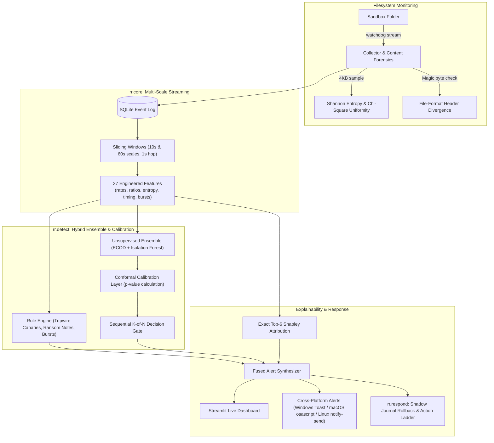

<div align="center">

# 🛡️ RansomRadar (v2)

**Cost-Sensitive, Explainable Ransomware Early Warning & Zero-Loss Recovery**

*An intelligent, multi-layer behaviour & content forensics system that catches crypto-ransomware in seconds, provides conformal risk-bounded alerts with exact Shapley attributions, and proves byte-for-byte rollback.*

[](https://www.python.org/)
[](INSTALL.md)
[](tests/)
[](app.py)
[](rr/detect/)
[](docs/minor_project_report.pdf)

---

### 🎓 Academic Information
**Minor Project Report — 5th Semester, B.E. Computer Science & Engineering**  
**Department of Computer Science & Engineering, Oriental University, Indore (M.P)**  
**Supervised by:** Prof. Suraj Batham  
**Team Members:**  
• Abhishek Yadav (PU00424EUG00647)  
• Samarth Mishra (PU00424EUG00716)  
• Pratik Goyal (PU00424EUG00707)  
• Yash Chaudhary (PU00424EUG00735)  

---

<p align="center">
  
  
  
</p>

</div>

---

## 📑 Project Deliverables & Documentation

All project documentation, report submissions, and presentation artifacts are available directly in [`docs/`](docs/):

| Document | Format | Description |
|---|---|---|
| **[Minor Project Report](docs/minor_project_report.pdf)** | PDF (29 pages) | Full university report: requirements, DFD/UML, system architecture, forensic mathematics, empirical evaluation, and viva defense findings. |
| **[Presentation Slides](docs/RansomRadar_Demo_Slides.pdf)** | [PDF](docs/RansomRadar_Demo_Slides.pdf) · [PPTX](docs/RansomRadar_Demo_Slides.pptx) | 18-slide presentation deck used for project evaluation and live demonstration. |
| **[Command Reference](docs/RansomRadar_Commands_Reference.pdf)** | PDF (3 pages) | Exact verification commands, single/multi-terminal options, attack variations, and test execution. |
| **[Presentation & Viva Guide](docs/RansomRadar_Presentation_Guide.pdf)** | PDF (20 pages) | 30-second pitch, concept explainers (conformal p-values, ECOD, Shapley), minute-by-minute demo script, and reviewer Q&A guide. |
| **[Cross-Platform Install Guide](INSTALL.md)** | Markdown | Step-by-step setup instructions for Windows 10/11, macOS (Apple Silicon/Intel), and Linux. |
| **[v2 Integration Contract](INTEGRATION_CONTRACT.md)** | Markdown | Formal modular architectural boundaries and schema specifications for `rr/`. |
| **[Quickstart Cheat Sheet](easyguide.txt)** | Text | 2-minute setup guide for both Windows and macOS users. |

---

## 💡 The Core Idea: Behaviour, Not Fingerprints

Traditional antivirus asks: *"Have we seen this executable hash or signature before?"*  
Ransomware attackers trivially bypass this with polymorphism, packers, or novel compilations.

**RansomRadar asks a fundamentally different question:**  
> *"What is this process actually doing to the filesystem?"*

Instead of evaluating arbitrary binary code, RansomRadar streams filesystem modification events, samples 4KB file blocks for forensic signals, aggregates multi-scale temporal windows, and applies a **conformal unsupervised anomaly ensemble** coupled with a **byte-for-byte shadow journal recovery system**.

### Differentiators

1. **Reality-Reflecting Metric:** Instead of abstract F1/accuracy on balanced synthetic datasets, we optimize **Files Lost Before Detection** vs **False Alarms Per Hour**.
2. **Conformal p-values:** Replaces arbitrary detection thresholds with calibrated p-values guaranteed under exchangeability against a held-out normal baseline ($\alpha = 0.01$).
3. **Dual Content Forensics:** Shannon entropy ($0 \le H \le 8$) combined with **$\chi^2$ byte uniformity testing** and **magic-header verification** to unmask intermittent and partial encryption.
4. **Built-in Adversary Evader:** We attack our own system using fast bursts, throttled stealth writes, and intermittent encryption (down to 15% file slice encryption) specifically engineered to evade entropy detectors.
5. **Exact Shapley Attribution:** Mathematical explanation for every alert calculating the exact top-6 feature coalitions driving the anomaly score.
6. **Zero-Loss Rollback (`verify_rollback.py`):** Pre-attack copy-on-write shadow journal restoring pristine files with automated SHA-256 verification (30/30 files verified byte-for-byte identical).

---

## 🏗️ System Architecture



---

## ⚡ Quickstart

### 1. Requirements & Setup

RansomRadar runs on **Python 3.11+** (tested up to 3.14).

```bash
# Clone the repository
git clone https://github.com/ariserhys/RR-RansomRadar-.git
cd RR-RansomRadar-

# Create and activate a virtual environment
python -m venv .venv

# Windows
.venv\Scripts\activate
# macOS / Linux
source .venv/bin/activate

# Install dependencies
pip install -r requirements.txt
```

### 2. Complete Presentation Demo (One Command)

```bash
python demo.py
```
This runs the full end-to-end demonstration:
- Calibrates on normal human-paced file activity
- Trains the anomaly detection models
- Simulates fast, stealth, and header-corruption attacks
- Displays desktop alerts in real time
- Launches the Streamlit dashboard at `http://localhost:8501`

### 3. Byte-for-Byte Rollback Proof

To demonstrate automated recovery with cryptographic proof:

```bash
python verify_rollback.py
```
**Verified Review Output:**
```text
[1/5] Baseline: 30 files protected in the shadow journal, 30 files hashed (SHA-256)
[2/5] Simulated attack: canary touch + mass rewrite + ransom note + .locked renames
[3/5] Damage report: 12 modified, 18 missing, 14 attacker-added
[4/5] Rollback: restoring pristine bytes from the journal...
      restored 30 file(s), verified_identical=True
      quarantined 14 attacker-added file(s)
[5/5] Proof: 30/30 files byte-for-byte identical to baseline (SHA-256) · all_recovered=True
RESULT: rollback verified — every original file came back byte-for-byte identical.
```

### 4. Run Test Suite

```bash
python -m pytest -q --disable-warnings
```
*73 tests passed covering unit, integration, conformal calibration, Shapley attribution, and safety boundaries.*

---

## 🔬 Scientific & Empirical Findings

From structured synthetic evaluation sessions comparing baseline rules against the full ML envelope:

| Detector Configuration | Detection Rate | Average Delay | False Alarms (Bulk Upload) |
|---|---|---|---|
| **Static Rules Only** | 2 / 6 | **0.0 s** (instant canary) | 1 / 2 (bulk copy triggers rule) |
| **Entropy Only** | 4 / 6 | 6.1 s | **0 / 2** |
| **Full Learned Envelope** | **6 / 6** | 6.3 s | **0 / 2** |
| **Fused (Rules + Envelope)** | **6 / 6** | 6.9 s | 1 / 2 |

### Intermittent / Partial Encryption Ablation

Modern ransomware (LockFile, BlackCat, Play, Qilin) encrypts only portions of files to defeat entropy detectors. RansomRadar counters this with header-divergence and $\chi^2$ uniformity checks:

| Attack Variation | Caught by Shannon Entropy Alone | Caught by Full RansomRadar |
|---|---|---|
| **Fast Bursts (Full)** | 2 / 2 | **2 / 2** |
| **Stealth Throttled (Full)** | 2 / 2 | **2 / 2** |
| **Partial / Header-Only** | **0 / 2 (MISSED)** | **2 / 2 (DETECTED)** |

---

## 📁 Repository Structure

```text
RR-RansomRadar-/
├── docs/                                 # Academic project deliverables & slides
│   ├── minor_project_report.pdf         # Complete 29-page project report
│   ├── RansomRadar_Demo_Slides.pdf      # Presentation slide deck (PDF)
│   ├── RansomRadar_Demo_Slides.pptx     # Presentation slide deck (PowerPoint)
│   ├── RansomRadar_Commands_Reference.pdf# Command cheat sheet & verify steps
│   ├── RansomRadar_Presentation_Guide.pdf# 20-page script, pitch & viva guide
│   └── screenshots/                     # Real dashboard captures for demonstration
│       ├── 01_normal_work.png
│       ├── 02_attack_alerts.png
│       └── 03_explain_canary.png
│
├── rr/                                  # RansomRadar v2 Modular Architecture
│   ├── core/                            # Streaming ingestion & forensic extraction
│   │   ├── featurize.py                 # 37-feature extraction over sliding windows
│   │   ├── forensics.py                 # Shannon entropy & chi-square calculation
│   │   ├── schema.py                    # NormalisedEvent & Window dataclasses
│   │   └── windows.py                   # Multi-scale sliding window generator
│   ├── detect/                          # ML models & explainability
│   │   ├── baselines.py                 # Envelope, write-threshold & random scorers
│   │   ├── detector.py                  # ECOD + Isolation Forest + Conformal p-values
│   │   └── shapley.py                   # Exact top-k Shapley feature attribution
│   ├── eval/                            # Rigorous evaluation & leak-free splits
│   │   ├── ablation.py                  # Leave-one-feature-out analysis
│   │   ├── figures.py                   # Pareto curve & tradeoff generation
│   │   ├── metrics.py                   # Files lost before detection & time-to-detect
│   │   └── protocol.py                  # Temporal split & session-group k-fold
│   ├── notify/                          # Cross-platform alert dispatcher
│   │   └── push.py                      # Push notification delivery
│   ├── respond/                         # Active response & automated recovery
│   │   ├── ladder.py                    # Tiered response policy ladder (T0..T4)
│   │   └── shadow.py                    # Copy-on-write pre-attack shadow journal
│   ├── sim/                             # Built-in adversary & synthetic simulator
│   │   ├── canaries.py                  # Realistic decoy generation & placement
│   │   ├── evader.py                    # Throttled, partial & canary-avoiding adversary
│   │   ├── manifest.py                  # Ground truth file hash verification
│   │   └── safety.py                    # Sandbox containment & directory traversal guards
│   └── compat.py                        # Seamless bridge between legacy and v2 pipelines
│
├── tests/                               # Comprehensive automated test suite (pytest)
│   ├── test_new_modules.py
│   ├── test_notify_push.py
│   ├── test_respond_ladder.py
│   ├── test_respond_shadow.py
│   └── test_sim_arena.py
│
├── app.py                               # Interactive Streamlit investigation dashboard
├── collector.py                         # Watchdog filesystem event observer
├── config.py                            # Central configuration, rules, & paths
├── db.py                                # SQLite storage layer for events and alerts
├── demo.py                              # End-to-end scripted viva demonstration
├── experiment.py                        # Automated benchmark & ablation experiment
├── features.py                          # Window featurizer & explanation generator
├── forensics.py                         # Content sampling, entropy & magic headers
├── model.py                             # Legacy normal envelope & model trainer
├── notify.py                            # OS native toasts (Windows, macOS, Linux)
├── rules.py                             # Hybrid live detector & v2 enhancement hook
├── simulator.py                         # Benign, bulk, fast, stealth & partial adversary
├── verify_rollback.py                   # Standalone SHA-256 byte-for-byte rollback proof
├── requirements.txt                     # Pinned project dependencies
├── INSTALL.md                           # Multi-platform setup manual
├── INTEGRATION_CONTRACT.md              # Architectural contracts & invariant guarantees
├── easyguide.txt                        # Quick reference instructions
└── LICENSE                              # Project license
```

---

## 🔒 Security & Safe Operating Doctrine

- **Contained Sandbox Operation:** RansomRadar operates strictly within a designated `sandbox/` directory. No external files or system files are ever modified or touched.
- **Simulated Adversary:** All attacks are generated by internal, controlled Python simulation functions. No real malware or malicious payloads are ever executed or required.
- **Fail-Safe Response Ladder:** Process termination and quarantine features default to `dry_run=True` and enforce an immutable protected-process allowlist to prevent system instability.
- **Zero Ingestion Leakage:** All training and calibration strictly enforce temporal ordering and session-level grouping with `assert_no_overlap` guards.

---

## ⚖️ License & Attribution

Developed as an Academic Minor Project at **Oriental University, Indore (M.P)**.  
Licensed under the [MIT License](LICENSE).
