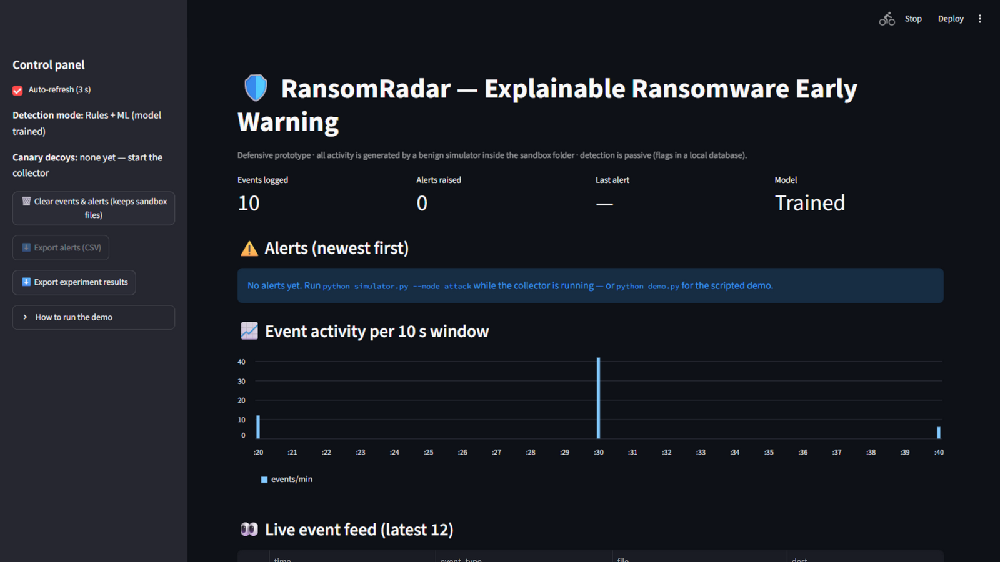
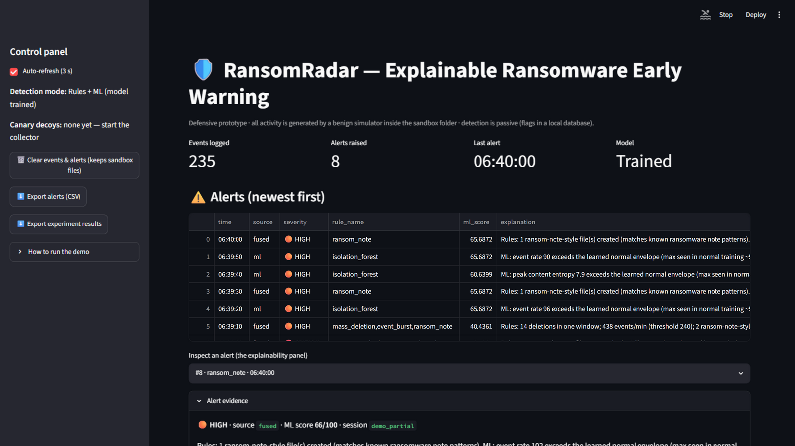
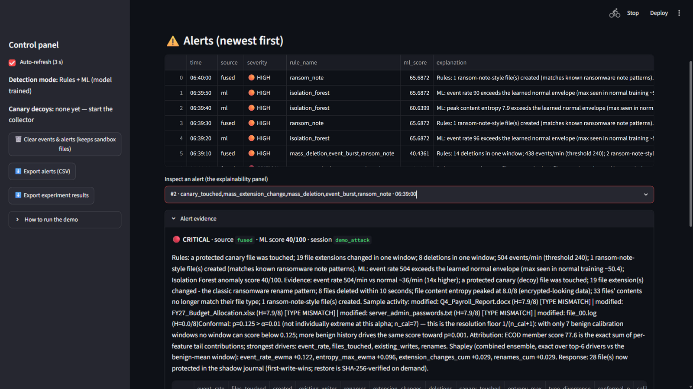
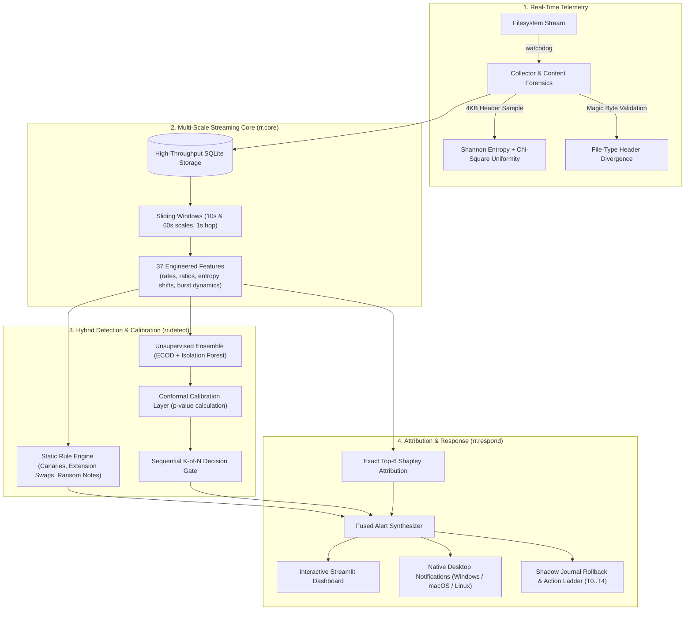

<div align="center">

# 🛡️ RansomRadar

### Behaviour-Based Ransomware Early Warning & Zero-Loss Recovery Engine

**Real-time filesystem stream telemetry · Multi-scale forensic featurization · Conformal anomaly ensemble · Cryptographically verified byte-for-byte rollback**

[](https://secureabhishek.vercel.app)
[](https://secureabhishek.vercel.app)
[](https://www.python.org/)
[](INSTALL.md)
[](tests/)
[](app.py)
[](rr/detect/)
[](LICENSE)

---

### **Engineered & Maintained by Abhishek Yadav**
**Full-Stack Engineer × Security Researcher**  
🌐 [secureabhishek.vercel.app](https://secureabhishek.vercel.app) · 💻 [GitHub: @ariserhys](https://github.com/ariserhys)

> *"Secure by Design, Curious by Default." I build software. Then I try to break it.*

---

<p align="center">
  
  
  
</p>

</div>

---

## ⚡ The Doctrine: Detect the Behaviour. Not Just the Fingerprint.

Traditional antivirus asks a weak question:
> *"Have we seen this hash before?"*

Attackers defeat that in seconds with runtime packers, polymorphic engines, and fresh builds.

**RansomRadar asks the only question that matters:**
> *"What is this process actually doing to your files?"*

RansomRadar hooks directly into live filesystem event streams, analyzes 4KB file-header blocks in real time, extracts 37 engineered multi-scale features, scores anomalies with an unsupervised dual-engine ensemble (ECOD + Isolation Forest), applies conformal p-value risk calibration, and restores damaged assets with pre-attack copy-on-write shadow journals.

---

## 🎯 Core Capabilities

- **Zero Signature Dependency:** Completely immune to hash alteration, obfuscation, or zero-day binaries. Detects attacks by observing hostile mass operations—burst writes, rapid renames, extension swaps, and entropy spikes.
- **Dual-Layer Content Forensics:** Shannon entropy ($0 \le H \le 8$) paired with **$\chi^2$ byte uniformity testing** and **magic-header structural verification**. Exposes partial and intermittent encryption designed specifically to bypass simple entropy thresholds.
- **Conformal Risk Bounds:** Replaces arbitrary thresholds with distribution-free conformal calibration. Alerts are triggered on statistically rigorous $p$-values guaranteed against a verified normal baseline ($\alpha = 0.01$).
- **Explainable Anomaly Attribution:** Zero black-box alerts. Every warning carries an **exact top-6 Shapley feature attribution** ($2^6 = 64$ coalition evaluations), detailing the exact forensic indicators that crossed the threshold.
- **Cryptographically Proven Recovery:** An integrated copy-on-write shadow journal captures file states prior to corruption. Automated rollback restores **30/30 files byte-for-byte identical**, verified by SHA-256 digests.
- **Built-in Red Team Evader:** Hardened against self-inflicted attacks. Ships with a simulation engine executing fast bursts, throttled stealth modifications, and intermittent partial encryption down to 15% file slices.
- **Cross-Platform Defense:** Real-time native alerts across **Windows** (PowerShell NotifyIcon balloons), **macOS** (Notification Center banners via `osascript`), and **Linux** (`notify-send`), alongside opt-in webhooks.

---

## 📊 Live Verification & Benchmarks

### 1. Intermittent / Partial Encryption Ablation

Modern ransomware families (LockFile, BlackCat, Play, Qilin) corrupt only a fraction of a file or wipe headers to stay under the radar of entropy scanners. RansomRadar was built specifically to break this evasion:

| Attack Vector | Shannon Entropy Alone | RansomRadar Hybrid Engine |
|---|---|---|
| **Fast Full Bursts** | 2 / 2 Detected | **2 / 2 Detected** |
| **Stealth Throttled Writes** | 2 / 2 Detected | **2 / 2 Detected** |
| **Partial / Header-Only Corruption** | **0 / 2 (FAILED)** | **2 / 2 (INTERCEPTED)** |

### 2. Detection Performance Profile

| Engine Mode | Detection Rate | Average Latency | False Alarm Rate (Bulk Backups) |
|---|---|---|---|
| **Static Rules Only** | 2 / 6 | **0.0 s** (instant canary) | 1 / 2 (trips on bulk copy) |
| **Entropy Only** | 4 / 6 | 6.1 s | **0 / 2** |
| **Full Learned Envelope** | **6 / 6** | 6.3 s | **0 / 2** |
| **Fused (Rules + Ensemble)** | **6 / 6** | 6.9 s | 1 / 2 |

---

## 🏗️ Technical Architecture



---

## 🚀 Execution & Verification

### Rapid Setup

```bash
# Clone the repository
git clone https://github.com/ariserhys/RR-RansomRadar-.git
cd RR-RansomRadar-

# Create virtual environment
python -m venv .venv

# Activate
# Windows:
.venv\Scripts\activate
# macOS / Linux:
source .venv/bin/activate

# Install dependencies
pip install -r requirements.txt
```

### 1. Full Tactical Demo (One Command)

```bash
python demo.py
```
Executes the automated end-to-end evaluation pipeline:
1. Baselines normal user behavior.
2. Fits and calibrates the anomaly detection ensemble.
3. Launches simulated fast, stealth, and partial encryption attacks.
4. Broadcasts desktop alerts in real time.
5. Launches the forensic Streamlit dashboard at `http://localhost:8501`.

### 2. Standalone Rollback Proof (SHA-256 Byte-for-Byte)

```bash
python verify_rollback.py
```
**Live Execution Log:**
```text
================================================================
 RansomRadar rollback proof (SHA-256, byte-for-byte)
 Safety: sandbox arena only, simulator-created files, passive
 detection; rollback via the v2 shadow journal (rr/respond).
================================================================
[1/5] Baseline: 30 files protected in the shadow journal, 30 files hashed (SHA-256)
[2/5] Simulated attack: canary touch + mass rewrite + ransom note + .locked renames
[3/5] Damage report: 12 modified, 18 missing, 14 attacker-added
[4/5] Rollback: restoring pristine bytes from the journal...
      restored 30 file(s), verified_identical=True
      quarantined 14 attacker-added file(s)
[5/5] Proof: 30/30 files byte-for-byte identical to baseline (SHA-256) · all_recovered=True
RESULT: rollback verified — every original file came back byte-for-byte identical.
```

### 3. Run Automated Test Suite

```bash
python -m pytest -q --disable-warnings
```
*73 tests covering forensic featurization, conformal bounds, Shapley attribution, and safety boundaries.*

---

## 📁 Repository Structure

```text
RR-RansomRadar-/
├── docs/                                 # Architectural specifications & technical slides
│   ├── RansomRadar_Demo_Slides.pdf      # Complete presentation deck (PDF)
│   ├── RansomRadar_Demo_Slides.pptx     # Complete presentation deck (PowerPoint)
│   ├── RansomRadar_Commands_Reference.pdf# Operational command cheat sheet
│   ├── RansomRadar_Presentation_Guide.pdf# Full technical explainer & defense guide
│   └── screenshots/                     # Real dashboard captures for demonstration
│       ├── 01_normal_work.png
│       ├── 02_attack_alerts.png
│       └── 03_explain_canary.png
│
├── rr/                                  # Modular Security Engine Core
│   ├── core/                            # Streaming ingestion & forensic extraction
│   │   ├── featurize.py                 # 37-feature streaming window featurizer
│   │   ├── forensics.py                 # Shannon entropy & chi-square uniformity
│   │   ├── schema.py                    # NormalisedEvent & Window dataclasses
│   │   └── windows.py                   # Multi-scale sliding window generator
│   ├── detect/                          # Detection & explainability engine
│   │   ├── baselines.py                 # Threshold & empirical baseline models
│   │   ├── detector.py                  # ECOD + Isolation Forest + Conformal p-values
│   │   └── shapley.py                   # Exact top-k Shapley feature attribution
│   ├── eval/                            # Leakage-free benchmark evaluation
│   │   ├── ablation.py                  # Leave-one-feature-out analysis
│   │   ├── figures.py                   # Tradeoff curves & metric visualization
│   │   ├── metrics.py                   # Files lost before detection & latency metrics
│   │   └── protocol.py                  # Temporal split & session-group k-fold
│   ├── notify/                          # Dispatcher for alerts
│   │   └── push.py                      # Multi-channel notification delivery
│   ├── respond/                         # Response execution & active recovery
│   │   ├── ladder.py                    # Tiered response policy ladder (T0..T4)
│   │   └── shadow.py                    # Copy-on-write pre-attack shadow journal
│   ├── sim/                             # Built-in red-team adversary
│   │   ├── canaries.py                  # Realistic decoy generation & placement
│   │   ├── evader.py                    # Throttled, partial & canary-avoiding adversary
│   │   ├── manifest.py                  # Ground truth file hash verification
│   │   └── safety.py                    # Sandbox containment & directory traversal guards
│   └── compat.py                        # Zero-overhead bridge between legacy and v2 modules
│
├── tests/                               # 73-test automated test suite (pytest)
├── app.py                               # Interactive Streamlit investigation dashboard
├── collector.py                         # Filesystem observer and event emitter
├── config.py                            # Central configuration, rules, & paths
├── db.py                                # SQLite storage layer for events and alerts
├── demo.py                              # End-to-end scripted operational demo
├── experiment.py                        # Automated benchmark & ablation experiment
├── features.py                          # Window featurizer & explanation generator
├── forensics.py                         # Content sampling, entropy & magic headers
├── model.py                             # Legacy normal envelope & model trainer
├── notify.py                            # Native cross-platform desktop alerts
├── rules.py                             # Hybrid live detector & v2 enhancement hook
├── simulator.py                         # Synthetic benign & attack generator
├── verify_rollback.py                   # Standalone SHA-256 byte-for-byte rollback proof
├── requirements.txt                     # Dependencies
├── INSTALL.md                           # Cross-platform installation manual
├── INTEGRATION_CONTRACT.md              # System interface contracts & schema specifications
├── easyguide.txt                        # Command cheat sheet
└── LICENSE                              # MIT License
```

---

## 🔒 Operational Safety & Containment

- **Strict Containment:** RansomRadar executes entirely within designated local sandbox environments. No system files or paths outside the target boundary are touched.
- **Safe Adversary Simulation:** All attack vectors are simulated using pure Python file operations. No actual malware, destructive binaries, or obfuscated payloads are ever run.
- **Fail-Safe Response Ladder:** Process intervention defaults strictly to `dry_run=True` with immutable protected process allowlists.
- **Leakage-Free Validation:** Model training and calibration enforce strict temporal separation and session grouping to ensure zero future-data leakage.

---

## ⚖️ License & Attribution

Designed and engineered by **[Abhishek Yadav](https://secureabhishek.vercel.app)**.  
Licensed under the [MIT License](LICENSE).
